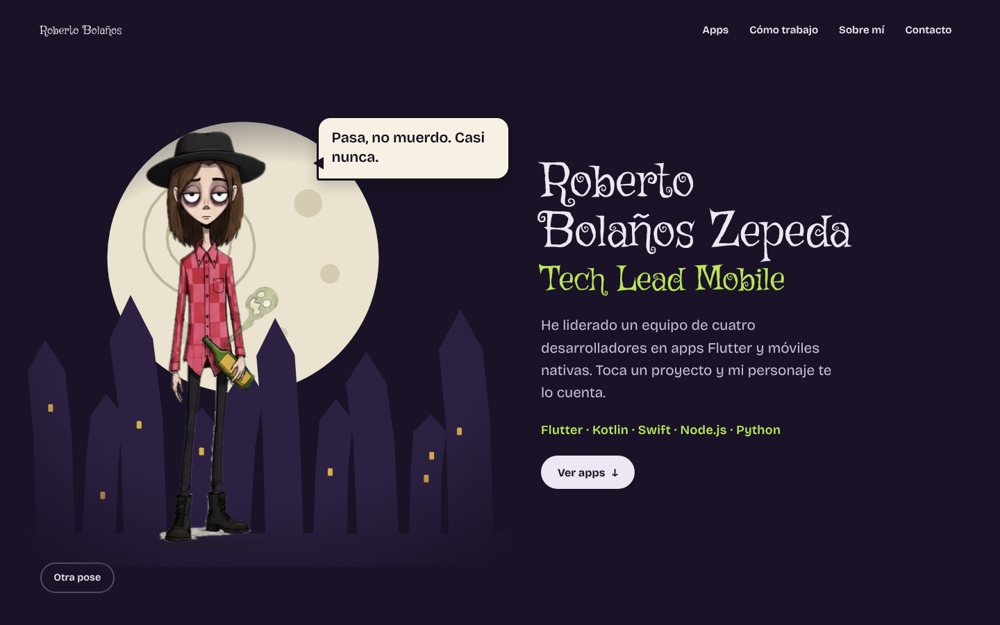

# Roberto Bolaños Zepeda

**Tech Lead Mobile · Flutter**

### [👉 Ver el portafolio en vivo](https://robertoboz.github.io/Portafolio/)

[](https://robertoboz.github.io/Portafolio/)

## Sobre mí

Soy Tech Lead Mobile en **IT Strategy**, donde lidero un equipo de cuatro desarrolladores que construye apps en Flutter y móviles nativas. Desarrollo con Flutter desde 2019. En el portafolio están las apps en las que he trabajado, cómo trabajo con mi equipo y cómo contactarme.

## Cómo está hecha la página

- **HTML, CSS y JavaScript, sin frameworks ni paso de compilación.** GitHub Pages la sirve tal cual.
- **Un personaje propio**, dibujado a mano y convertido en 13 poses. Se anima en un `<canvas>`: respira, parpadea y mueve la boca al hablar en un globo de diálogo.
- **Cada sección cambia los colores, el fondo y la pose del personaje** al hacer scroll. El ambiente está inspirado en los cuentos góticos de Tim Burton.
- **Accesible:** se maneja con teclado, respeta "reducir movimiento" del sistema y funciona en celular.
- **Resistente a fallos:** si alguna imagen no carga, esa pose se salta y la página sigue funcionando.

## Estructura del repo

```
index.html          contenido de la página (secciones y textos)
css/estilos.css     colores por sección, diseño y animaciones
js/poses.js         las 13 poses: nombre, frase y puntos de la cara
js/cara.js          boca y parpadeo del personaje
js/avatar.js        dibujo en el canvas, transiciones y globo de diálogo
js/pagina.js        scroll entre secciones, botones y copiar correo
img/poses/          una imagen .webp por pose
docs/               captura y documentos de diseño
```

## Cómo editarla

- **Cambiar lo que dice el personaje:** en `js/poses.js`, edita el texto de `phrase` de la pose.
- **Cambiar los textos de la página:** edita `index.html`.
- **Reemplazar una pose:** sustituye el archivo en `img/poses/` por otro `.webp` con el mismo nombre. Si cambia el tamaño, actualiza `w` y `h` de esa pose en `js/poses.js`.
- **Verla en tu computadora:** descarga el repo y abre `index.html` con doble clic. No necesita servidor.

Los cambios que subas a la rama `main` se publican solos en GitHub Pages en uno o dos minutos.

## Contacto

- Correo: [robertobolanoszepeda@gmail.com](mailto:robertobolanoszepeda@gmail.com)
- LinkedIn: [Roberto Bolaños Zepeda](https://www.linkedin.com/in/roberto-bola%C3%B1os-zepeda-63614519b/)
- GitHub: [@RobertoBoz](https://github.com/RobertoBoz)
